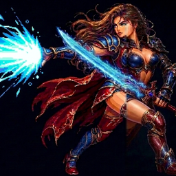
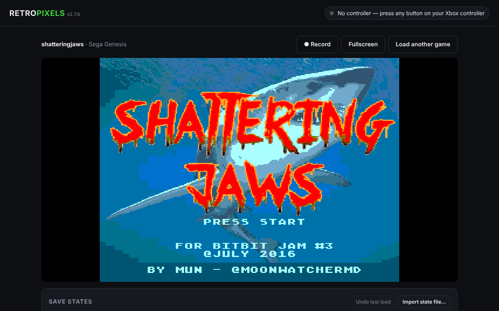
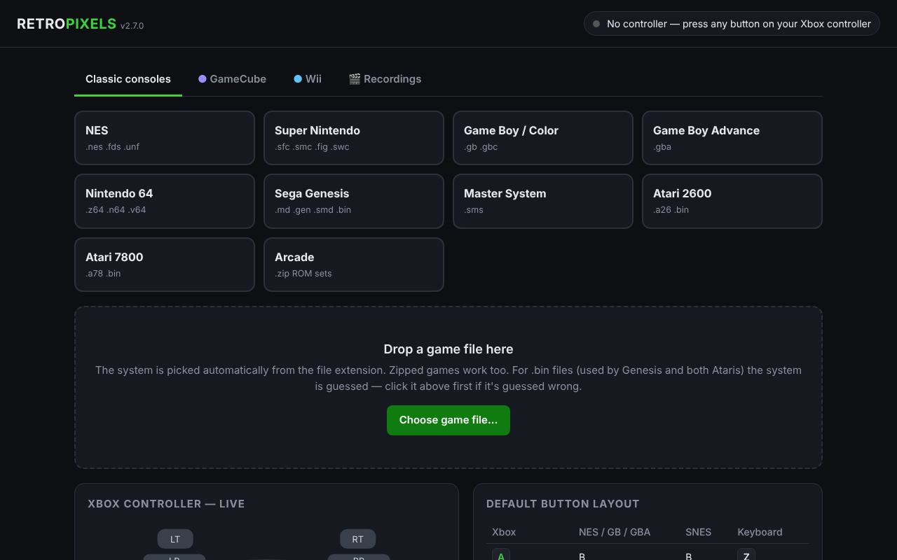

<p align="center"></p>

<h1 align="center">RetroPixels</h1>

<p align="center">
  Classic consoles and arcade games for Windows, on emulators written from scratch.
</p>

<p align="center">
  <a href="../../releases/latest"></a>
  
  
  <a href="../../actions/workflows/ci.yml"></a>
</p>

<p align="center">
  <a href="../../releases/latest"><b>Download</b></a> ·
  <a href="#features">Features</a> ·
  <a href="#supported-systems">Systems</a> ·
  <a href="#building-from-source">Build</a> ·
  <a href="#support-development">Donate</a> ·
  <a href="CHANGELOG.md">Changelog</a>
</p>

<p align="center">
  
</p>

RetroPixels is a single Windows program that plays games from eleven classic systems and a set of
arcade boards. Every emulator in it (the CPUs, graphics and sound chips, cartridge hardware and the
arcade boards) is RetroPixels' own code. It runs offline and needs no BIOS files for the built-in
systems. GameCube and Wii games play through [Dolphin](https://dolphin-emu.org/), shown inside the
RetroPixels window.

> RetroPixels does not include any games, ROMs, BIOS or firmware. Use copies of games you own.

## Features

- **One window for everything.** Drop a game file on the window; zipped games open directly and the
  system is detected from the file.
- **Xbox controllers work out of the box**, with per-system button remapping, rumble and analog
  sticks where the game uses them. Up to four players.
- **Choose your player** in 4-player arcade games: play as Leonardo, Michelangelo, Donatello or Raphael,
  or Marge, Homer, Bart or Lisa, from buttons above the game.
- **Recording that captures only the game.** Videos contain just the game picture and sound, with
  no window borders, cursor, black bars or other apps.
- **Saves handled for you.** Battery saves are kept automatically; save states with undo; import
  `.sav` / `.srm` files from other emulators.
- **Cartridge hardware** emulated in software: SNES Super FX, SA-1, DSP-1/2, Cx4, S-DD1, SPC7110;
  about 120 NES mappers and the Famicom sound chips; Game Boy MBC1–7, HuC1/3, TAMA5; GBA sensor
  carts; Atari 2600 bank-switching including DPC+ and the Supercharger.
- **Archipelago multiworld randomizers.** Open an Archipelago patch file and play; the Archipelago
  SNI Client and BizHawk Client connect to RetroPixels directly.
- **GameCube and Wii** through Dolphin, downloaded from inside the app, with a library, volume
  control and automatic recording.
- **Any arcade game in any version of MAME, with MAME built in.** The download comes with the MAME
  team's official Windows release of MAME, unchanged. Add as many other MAME versions as you like
  (your own `mame.exe`, found on your PC, or any official release downloaded from inside the app).
  RetroPixels checks which version plays each game, and plays it inside the RetroPixels window.

## Supported systems

| System | Files | Notes |
| --- | --- | --- |
| NES / Famicom | `.nes` `.unf` | ~120 mappers, VRC6, VRC7, N163, 5B, MMC5 audio |
| Super Nintendo | `.sfc` `.smc` `.fig` `.swc` | Super FX, SA-1, DSP-1–4, Cx4, S-DD1, SPC7110, ST010/011/018 ¹ |
| Game Boy / Color | `.gb` `.gbc` | MBC1–7, HuC1/3, MMM01, TAMA5, real-time clock |
| Game Boy Advance | `.gba` | Solar, gyro, tilt and rumble cartridges |
| Nintendo 64 | `.z64` `.n64` `.v64` | Runs natively inside `RetroPixels.exe` |
| Wii U | `.rpx` homebrew | New, RetroPixels' own emulator: OSScreen and GX2 (3D) homebrew on the TV and GamePad, drawn on the graphics card with Direct3D 11 on Windows; commercial games come later |
| Sega Genesis / Mega Drive | `.md` `.gen` `.smd` `.bin` | EEPROM saves, J-Cart, Realtec, SSF2 |
| Sega Master System | `.sms` | |
| Atari 2600 | `.a26` `.bin` | Nearly all bank-switching schemes, paddles |
| Atari 7800 | `.a78` `.bin` | SuperGame, POKEY, banksets |
| Arcade | `.zip` ROM sets | Pac-Man, Galaxian, Space Invaders, Donkey Kong, TMNT, TMNT: Turtles in Time, The Simpsons, 1941, 1942, 1943, 1943 Kai, Altered Beast, Asteroids Deluxe, Berzerk, Centipede, Vs. Castlevania, Donkey Kong Jr., Donkey Kong 3, Galaga, Dig Dug, Double Dragon, Double Dragon II, Double Dragon 3, The Real Ghostbusters, Dragon Blaze |
| GameCube / Wii | `.iso` `.gcm` `.rvz` `.wbfs` `.ciso` `.gcz` `.wia` `.wad` | Through Dolphin |
| Arcade (MAME) | `.zip` `.7z` ROM sets | Through MAME: built in, or any other version, chosen per game |

¹ DSP-3, DSP-4, ST010, ST011 and ST018 run a program stored inside the chip. RetroPixels asks for
your own dump of it the first time and remembers it.

## Getting started

1. Download `RetroPixels-x.y.z.zip` from the [latest release](../../releases/latest) and unzip it.
2. Run `RetroPixels.exe`.
3. Drop a game onto the window, or click **Choose game file…**.

**Requirements:** Windows 10 or 11, 64-bit, with Microsoft Edge (built into Windows; RetroPixels
uses it to draw its window). For recording, RetroPixels downloads ffmpeg the first time it is needed.

> [!NOTE]
> The executable is not code-signed yet, so Windows SmartScreen may show *"Windows protected your PC"*.
> Click **More info**, then **Run anyway**.

<p align="center">
  
</p>

## Archipelago

RetroPixels works with [Archipelago](https://archipelago.gg) multiworld randomizers. It takes the
place of both the emulator and the connector: the SNI Client and the BizHawk Client from the
Archipelago Launcher talk to RetroPixels directly, so you don't need SNI, BizHawk or a Lua script.

1. Open your patch file (for example `AP_..._P1_Name.apsm`, `.aplttp`, `.apred`, `.apemerald`) like
   any game: drop it on the window or click **Choose game file…**.
2. The first time, RetroPixels asks for the original ROM the game's Archipelago setup guide names
   (a zipped ROM works too). It checks it is the right one and keeps it, so the next patch for that
   game opens straight away. The patched game gets its own saves, separate from the unpatched game.
3. In the Archipelago Launcher start the **SNI Client** (Super Nintendo games) or the **BizHawk
   Client** (Game Boy / Color, Game Boy Advance, NES, Nintendo 64), and connect it to the server
   (for example `/connect archipelago.gg:38281`).
4. Play. The **Archipelago** button in the bar under the game shows whether the client is
   connected; click it for these steps.

Already patched the ROM with the Archipelago Launcher? Open the patched ROM instead; that works the
same way. Patches whose games need extra Python steps to build the ROM (Kirby's Dream Land 3,
Castlevania 64, Castlevania: Circle of the Moon, EarthBound, Mario & Luigi: Superstar Saga,
Link's Awakening DX, SMZ3, Gauntlet Legends) can't be applied inside RetroPixels: RetroPixels says
so and you make the ROM with the Launcher's **Open Patch**, then open that ROM. Games that use their
own connector script (for example The Legend of Zelda, Link's Awakening DX, Ocarina of Time) aren't
supported. RetroPixels only listens on this computer (127.0.0.1: port 23074 for SNI, 43055–43059
for BizHawk) and never connects to the Archipelago server itself.

## Arcade games in MAME

RetroPixels' own arcade emulators play the games in the table above. Every other arcade game plays
in [MAME](https://www.mamedev.org), and in **any version of MAME**: ROM sets have to match the MAME
version they were made for, so RetroPixels lets each game use its own.

**MAME is built in.** The `RetroPixels-<version>.zip` download has a `MAME` folder with the MAME
team's own official Windows release of MAME, unchanged: the release build downloads it from
[MAME's GitHub releases](https://github.com/mamedev/mame/releases), checks it against the SHA-256
checksum GitHub lists for it, and packs it as it is (`tools/bundlemame`). Nothing in MAME is rebuilt,
patched or rewritten. Its source code for that exact release is attached to each RetroPixels release
(`MAME-<version>-source.tar.gz`). It shows as **MAME 0.xxx (built in)** and is the default when you
have no other MAME. Put your ROM sets in `MAME\roms`, or add your own ROM folder.

1. Open the **Arcade (MAME)** tab (in RetroPixels Native: the **Arcade (MAME)** menu > Library).
2. Add MAME: **Add MAME…** for a `mame.exe` you have (any version), **Find MAME on this PC**, or
   pick a version under **Download a MAME version**. Downloads are the MAME team's official Windows
   releases from [github.com/mamedev/mame](https://github.com/mamedev/mame/releases), checked
   against the checksum GitHub lists, each unpacked into its own `MAME 0.xxx` folder next to
   RetroPixels, so versions never replace each other. Add as many as you like.
3. **Add ROM folder…** with your ROM sets (`tmnt.zip`, `sf2.zip`…). The library lists them by name.
4. Next to each game, choose the MAME version it plays in (or leave it on the default), then **Play**.
   The game plays inside the RetroPixels window; **Stop game** brings you back. If a game doesn't
   start, RetroPixels shows MAME's reason (for example missing ROM files) so you can try another
   version.
5. RetroPixels asks each of your MAME versions which games it plays (MAME's own `-verifyroms`, once
   per game and version) and shows it next to each game: **Plays in MAME 0.xxx**, or **Won't start**
   with the versions that do play it. A game its default version can't play starts in one that can,
   unless you picked a version for it. Old ROM sets often lack chips newer MAME versions need: those
   play in an older MAME version, or with an up-to-date set.

MAME keeps its own settings, saves and save states in its folder; RetroPixels doesn't change them.

## RetroPixels Native (test build)

RetroPixels is being rebuilt as a native Windows program, with no web browser inside, so OBS Studio's
Window Capture records it with any capture method. Each release includes the current test build as
`RetroPixels-Native.exe`, next to `RetroPixels.exe`. It plays **every system RetroPixels.exe plays**: **Super Nintendo**, **NES**, **Atari 2600**, **Master System**, **Game Boy / Color**, **Atari 7800**, **Genesis**, **Game Boy Advance**, **Nintendo 64**, **Wii U** (homebrew), **arcade** and **GameCube / Wii** (through Dolphin) games so far, with a start screen, four save-state slots and screenshots,
using Go ports of the same emulators, checked frame by frame and sample by sample against them. More
systems follow in later test builds; until then, `RetroPixels.exe` plays everything.

## RetroPixels for Android

Each release includes **RetroPixels-<version>.apk** for Android 7 or newer, playing the same systems as RetroPixels Native with touch controls and controller support, and **RetroPixels-Android-Studio-<version>.zip**, an Android Studio project with the emulator engine prebuilt (File > Open the `android` folder, then Build APK). The source is in [`android/`](android/); the Go emulators run as a small engine program inside the app (`cmd/retropixels-android`), so no NDK is needed. Not yet tested on a real phone.

## Building from source

RetroPixels is a Go program with an embedded web front end; no C toolchain is required.

```sh
git clone https://github.com/Shredder565/RetroPixels.git
cd RetroPixels
go test ./...
GOOS=windows GOARCH=amd64 CGO_ENABLED=0 \
  go build -trimpath -ldflags "-s -w -H windowsgui" -o RetroPixels.exe .
```

Requires Go 1.24 or newer. The program icon and file details come from `rsrc_windows_amd64.syso`;
after changing `winres/icon.ico` or the version, run `sh tools/make-winres.sh`. When the version in `main.go` changes on `main` (or a tag such as `v2.7.0` is pushed), GitHub Actions builds the program and publishes the release with the .exe, the zip and the source code.

### Project layout

| Path | What it is |
| --- | --- |
| `main.go`, `*.go` | Windows app: app window, Dolphin and MAME integration, recording, settings |
| `internal/mame/` | MAME versions, official downloads, ROM library and launching, shared by both apps |
| `web/index.html` | The app's interface |
| `web/emu/` | The emulators: CPUs (6502, 65C816, Z80, 68000, ARM, Konami-2, 8080…), video and sound chips, arcade boards |
| `n64/` | Nintendo 64 emulator (CPU, RSP, RDP), run natively |
| `wiiu/` | Wii U emulator (PowerPC 750CL, RPX loader, system libraries), run natively |
| `cmd/retropixels-native/`, `core/`, `cores/` | RetroPixels Native: the Win32 app and the native emulators |
| `sevenzip/` | `.7z` extractor (LZMA, LZMA2, BCJ, BCJ2) |
| `docs/` | Project website (GitHub Pages) |

## Support development

RetroPixels is free to download and built by one developer. If you enjoy it, a donation helps fund
new systems, more arcade boards, accuracy work and code signing (so Windows stops warning about the
download).

<p>
  <a href="https://github.com/sponsors/Shredder565"></a>
</p>

You can also use the **Sponsor** button at the top of this repository. Thank you!

## Changelog

See [CHANGELOG.md](CHANGELOG.md) for every release.

## Legal

RetroPixels contains no copyrighted game code, BIOS or firmware. Its emulators are written from
scratch, except for parts of the Wii U emulator: some files in `wiiu/` are Go rewrites of code from
[Cemu](https://github.com/cemu-project/Cemu). Those files are under the Mozilla Public License 2.0
(see `wiiu/LICENSE-MPL-2.0.txt`), say so at the top, and name the Cemu files they come from.
Thanks to the Cemu team. Game and system names are trademarks of their respective owners and are used only to
describe compatibility. RetroPixels is not affiliated with or endorsed by Nintendo, Sega, Atari,
Konami, Namco, Microsoft, the Dolphin project, the Cemu project or the MAME team.

Screenshot: *Shattering Jaws*, a Genesis homebrew game by Mun (2016).

Copyright © 2026 RetroPixels. All rights reserved.
